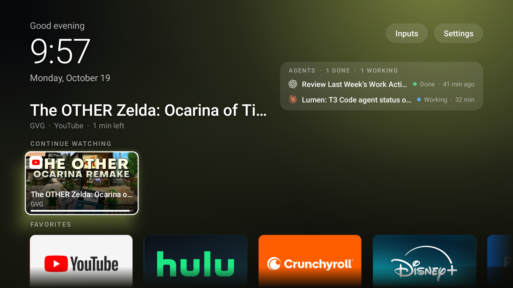
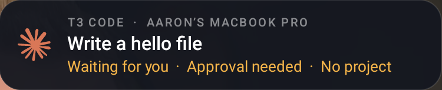

# Lumen

This page shows you how to get started with Lumen and find its setup, privacy, and support documentation.

Lumen is an experimental home-screen launcher for Android TVs with local watch history and optional coding-agent status.

Lumen is a personal project, currently version 0.1.0, available only as source. You must build it yourself; there is no official APK. Its current package name, `local.tvhome`, will change before an official binary release, so a later official build won't install over your self-built app.

## Features

- See a clock, date, and greeting, including holiday greetings.
- Use **Now playing** to see artwork, a title, and the app for playing or paused media. Select its play/pause button to control playback, or press **OK** on the card to open the player. The card hides when nothing is playing or paused.
- Return to the latest 10 shows and movies in **Continue watching**, with artwork, episode information, and progress. Lumen builds its own history as you watch; it can't read Google TV's list. Lumen excludes selected music, casting, and live-TV apps. Other apps that publish media sessions can appear in watch history. Home focuses this row when it has shows.
- Choose **Settings > Rows** for separate favorites and app rows, or **Settings > Grid** for apps five across.
- Find installed TV apps automatically with their own banners. Press and hold **OK** on an app for favorite, move, hide, and app-information options. See [Customize your home screen](docs/quickstart.md#customize-your-home-screen) for the available actions.
- Select **Inputs** to see HDMI ports, connected-device names from HDMI-CEC, and connection status.
- See the background color change with the focused app.
- Optionally show T3 Code chat status and notifications from your Mac. Both features start off on new installs. See [Set up Lumen Agents](docs/set-up-agents.md#before-you-begin).
- Use Lumen without analytics or tracking. The app uses about 50 MB of memory (measured with `dumpsys meminfo` on the tested TV).

Lumen uses the Android framework without libraries or Gradle.

## Status and compatibility

| Area | Compatibility |
| --- | --- |
| Android | Minimum Android 9 (API 28); target API 31. |
| Tested TV | One Sony BRAVIA with Google TV running Android 12 (API 31). Other TVs and Android TV builds are untested. |
| Home button | The accessibility service assumes the Google TV launcher, `com.google.android.apps.tv.launcherx`. |
| Live TV | The **Live TV** input appears only when Sony's Live TV app is installed. |
| Initial favorites | US streaming apps; Lumen skips apps that aren't installed. You can change favorites with the remote. Source builds define defaults in `DEFAULT_FAVORITES` in `src/local/tvhome/HomeActivity.java`. |
| Build tools | Android SDK build-tools 36.0.0, platform 34, platform-tools, and JDK 17. |
| Lumen Agents | macOS only; tested with T3 Code (Beta) 0.1.0 and orchestration protocol 2. |

Lumen Agents is an unofficial integration with T3 Code and is not affiliated with or endorsed by T3 Tools, Inc. It uses an internal, undocumented interface that may change without notice.

## Screenshots

The screenshot files are planned for the following locations:

## Get started

Before you run a setup procedure, check its **Before you begin** section.

- [Build and install Lumen](docs/quickstart.md#before-you-begin).
- [Pair Lumen with your Mac](docs/set-up-agents.md#before-you-begin).
- [Diagnose setup and runtime problems](docs/troubleshooting.md#before-you-begin).
- [Restore your launcher and remove Lumen](docs/uninstall.md#before-you-begin).

## Privacy and security

Watch history stays on your TV. Lumen makes no network connections when Agents and agent notifications are off. With either feature on, it connects to the helper on your Mac over your local network.

- [Review TV and Mac storage and permissions](PRIVACY.md#tv-data-and-permissions).
- [Understand pairing and security limitations](SECURITY.md#security-design).
- [Report a vulnerability privately](SECURITY.md#report-a-vulnerability).

## Contribute

Read the [contribution prerequisites](CONTRIBUTING.md#before-you-begin), [code conventions](CONTRIBUTING.md#code-conventions), and [bug-reporting instructions](CONTRIBUTING.md#report-a-bug).

## Support the project

Lumen is free. If it's useful to you, you can [buy me a coffee](https://buymeacoffee.com/aaronmolina).

## License and notices

Lumen is released under the [MIT License](LICENSE), Copyright (c) 2026 Aaron Molina. The model logos in `res/drawable/brand_*.xml` are adapted from [Lobe Icons](https://github.com/lobehub/lobe-icons) (MIT, Copyright (c) 2023 LobeHub). See [third-party notices](THIRD_PARTY_NOTICES.md). You can also read the notices in **Settings > Licenses & notices**.

Product names and logos, including Anthropic and Claude, OpenAI, xAI and Grok, Google, Gemini, Google TV, Android and YouTube, Cursor and Anysphere, OpenCode, T3 Code, Sony and BRAVIA, Netflix, and others mentioned here, belong to their respective owners. They identify the model or app; the MIT License grants no trademark rights. Lumen isn't affiliated with or endorsed by any of them.

## What's next

Follow [Quickstart: Install Lumen](docs/quickstart.md#objectives).
